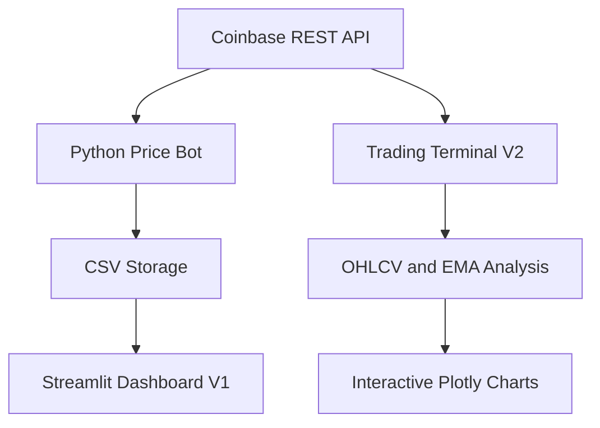

# ₿ Bitcoin Market Tracker

A live cryptocurrency market monitoring application built using Python, Streamlit, Plotly, and the Coinbase Exchange REST API.

The project demonstrates API integration, real-time data collection, historical data storage, interactive visualization, and technical market analysis.

## Project Features

### Price Tracking Bot (V1)

- Live BTC/USD price retrieval
- Automatic polling every 10 seconds
- Percentage price change calculation
- Timestamp-based historical data collection
- Persistent CSV storage
- API error handling

### Market Dashboard (V1)

- Live Bitcoin price visualization
- Recorded highest and lowest prices
- Interactive historical price chart
- Recent market data table
- Automatic dashboard refresh
- Stale data detection

### Trading Terminal (V2)

- Interactive OHLCV candlestick charts
- Six selectable timeframes: 1m, 5m, 15m, 1h, 6h, 1D
- EMA 20 and EMA 50 indicators
- Trading volume visualization
- Adjustable number of visible candles
- Automatic market updates
- Historical candle data export as CSV
- Independent operation without the price collection bot

## System Architecture



## Technology Stack

| Technology | Purpose |
|---|---|
| Python | Application development |
| Coinbase REST API | Cryptocurrency market data |
| Requests | HTTP communication |
| Pandas | Data processing |
| Streamlit | Web application |
| Plotly | Interactive financial visualization |
| CSV | Persistent data storage |
| Git and GitHub | Version control |

## Project Structure

```text
btc-market-tracker/
├── btc_bot.py
├── app.py
├── app_v2.py
├── requirements.txt
├── README.md
└── .gitignore
```

## Installation

Clone the repository:

```bash
git clone https://github.com/anjani147/btc-market-tracker.git
cd btc-market-tracker
```

Install dependencies:

```bash
python -m pip install -r requirements.txt
```

## Running the Application

### Price Collection Bot

```bash
python btc_bot.py
```

The bot automatically creates btc_history.csv and continuously records market data.

### Basic Dashboard

Open another terminal while the bot is running:

```bash
python -m streamlit run app.py
```

Access the dashboard at http://localhost:8501.

### Advanced Trading Terminal

```bash
python -m streamlit run app_v2.py --server.port 8502
```

Access the advanced dashboard at http://localhost:8502.

The advanced dashboard retrieves market data directly from Coinbase and does not require the background bot.

## Historical Data

The price collection bot records the following fields:

| Field | Description |
|---|---|
| Timestamp | Local data collection time |
| Price | Latest BTC/USD traded price |
| Change_Percent | Change from the previous recorded price |
| Volume | Reported 24-hour trading volume in BTC |

Generated CSV files can be opened using Microsoft Excel, Pandas, or other data analysis tools.


## Disclaimer

This project is developed for educational purposes, software development practice, and cryptocurrency market monitoring. It does not provide financial advice or automated trading services.
